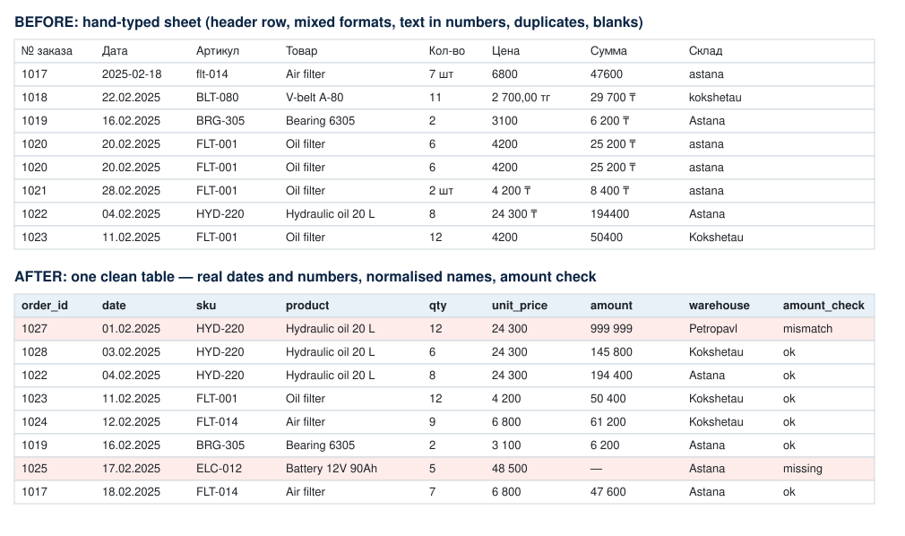

# Excel Data Cleaner — messy monthly sheets → one reliable table

A small, repeatable Python tool for a very common business problem: sales or
warehouse reports typed by hand into Excel, one sheet per month, each sheet a
little different. The script merges them into **one clean table**, lists every
row it could not fix with confidence, and builds a short summary.



## The problem

Hand-typed workbooks usually contain:

- a title row above the real header, and **different column names** on every sheet (EN / RU);
- **dates in several formats** — real Excel dates, `22.02.2025`, `03/25/2025`, `2025-02-18`;
- **numbers stored as text** — `2 700,00 тг`, `29 700 ₸`, `7 шт`, or words like `уточнить`;
- inconsistent codes and names — ` flt-014 `, `astana` / `Astana`, `OIL FILTER`;
- **duplicates, blank rows and hand-typed TOTAL rows** (often with a wrong total);
- amounts that do not match quantity × price.

## What the script does

| Step | How |
|---|---|
| Find the header | scans each sheet for the first row that matches ≥ 4 known column names; sheets without one (e.g. notes) are skipped |
| Unify columns | maps EN/RU spellings (`Qty`, `Кол-во`, `quantity` → `qty`) to one standard set |
| Parse dates | dots = day-first (KZ/RU convention); for slashes the **whole sheet** decides day-first vs month-first; if there is no evidence the row is **flagged, not guessed silently** |
| Convert numbers | strips currency signs, units and spaces; handles decimal commas |
| Normalise text | SKU upper-case and trimmed, warehouse names in Title Case, one product name per SKU |
| Remove junk | blank rows, TOTAL rows, exact duplicates |
| Check the business rule | `amount = qty × unit_price`; mismatches and missing amounts go to **Issues** |
| Report | writes `Clean`, `Issues` and `Summary` (revenue by month × warehouse, only verified rows) |

Every row in `Clean` and `Issues` keeps `source_sheet` and `source_row`, so any
value can be traced back to the original file.

## Result on the sample file

```
Read sheets: Jan 2025, февраль, Mar-25 | skipped: notes
Rows in: 56 -> out: 47 (blank 3, totals 3, duplicates 3)
Rows flagged for review: 6 -> see sheet 'Issues'
```

## Run it

```bash
pip install -r requirements.txt

# 1) create the messy sample workbook (synthetic data)
python src/make_sample.py sample_data/orders_messy.xlsx

# 2) clean it
python src/clean_orders.py sample_data/orders_messy.xlsx output/orders_clean.xlsx

# 3) tests
python -m pytest -q
```

## Project structure

```
src/make_sample.py      # builds a deliberately messy workbook (synthetic data)
src/clean_orders.py     # the cleaner: read → standardise → validate → write
tests/                  # 15 pytest tests: parsing rules + end-to-end checks
sample_data/            # messy input example
output/                 # cleaned output example (Clean / Issues / Summary)
docs/before_after.svg   # before/after image used above
```

## Adapting it to another file

Add your column spellings to `ALIASES` in `src/clean_orders.py` and, if the
business rule is different (e.g. price per night × nights), change the check
in `clean()`. Everything else works as is.

## Limitations

- Ambiguous slash dates (both parts ≤ 12) on a sheet with no other evidence are
  assumed month-first **and flagged** — a person should confirm them.
- The script does not guess a corrected amount; mismatches are left for review.
- All data in this repository is synthetic.

---

Author: Adilkhan Mustakhan — logistics & data analyst (Excel, Python, Power BI).
